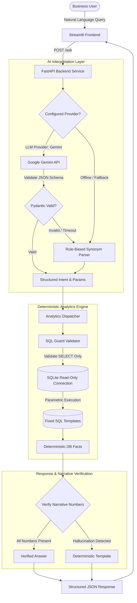

# Mini AI Business Intelligence Assistant

An AI-assisted Business Intelligence application built for the Graduate Engineer Trainee (GET) selection challenge at **RSG Research Private Limited**.

The system enables business stakeholders to ask natural language questions regarding sales performance and receive accurate, deterministic answers backed by parameterized database queries, interactive visual charts, and an auditable data-quality log.

---

## Table of Contents
- [Executive Overview](#executive-overview)
- [Key Features](#key-features)
- [Technology Stack](#technology-stack)
- [Architecture & Safety Design](#architecture--safety-design)
  - [Architecture Diagram](#architecture-diagram)
  - [Safety & Zero-Hallucination Guarantees](#safety--zero-hallucination-guarantees)
- [Business Rules & Data Contract](#business-rules--data-contract)
  - [Formula & Assumptions](#formula--assumptions)
  - [Inclusion & Exclusion Audit Trail](#inclusion--exclusion-audit-trail)
  - [Verified Benchmark Metrics](#verified-benchmark-metrics)
- [Setup & Execution Guide](#setup--execution-guide)
  - [Windows (PowerShell)](#windows-powershell)
  - [macOS / Linux (Bash)](#macos--linux-bash)
- [API Documentation](#api-documentation)
- [User Interface](#user-interface)
- [Automated Testing Suite](#automated-testing-suite)
- [Project Structure](#project-structure)
- [Known Limitations](#known-limitations)
- [Troubleshooting & Debugging](#troubleshooting--debugging)
- [Future Enhancements](#future-enhancements)

---

## Executive Overview
Traditional natural language data assistants often rely on unconstrained Text-to-SQL generation. In production business intelligence, this introduces severe risks: hallucinated metric calculations, schema hallucinations, nondeterministic aggregations, and potential SQL injection vulnerabilities.

This application employs a **Deterministic Intent-Driven Architecture**:
1. **The AI Layer (LLM or Rule-Based Fallback)** is strictly limited to extracting the user's intent and parameters (e.g., target months) as validated JSON.
2. **The Database Engine (SQLite)** executes fixed, parameterized SQL queries against a strict read-only connection.
3. **The Response Synthesizer** formats facts into clear business answers and verifies that any generated narrative contains only verified numbers from the database.

---

## Key Features
- **Deterministic Analytics**: Zero LLM-generated SQL or ungrounded arithmetic. Every figure originates from a tested, parameterized query.
- **Dual Interpretation Layer**:
  - **Offline Rule-Based Interpreter**: Works out-of-the-box with 0 API keys and zero internet access. Handles natural language synonyms, abbreviations, and varied sentence structures.
  - **LLM Interpreter**: Configurable support for Google Gemini via `google-genai` with automatic, seamless fallback to the rule-based engine upon error or timeout.
- **Defense-in-Depth Security**:
  - `sql_guard`: AST-like validator blocking mutation keywords, query chaining (`;`), and SQL comments.
  - Read-only SQLite connection URI (`?mode=ro`) with SQLite engine-level `PRAGMA query_only = ON`.
- **Data Quality & Auditability**:
  - Non-destructive data loading: raw records are preserved unaltered.
  - Excluded records are tracked with explicit exclusion reason codes (`returned`, `zero_quantity`, `missing_unit_price`).
  - Dedicated `/data-quality` endpoint and UI expander.
- **Interactive Web UI**: Built with Streamlit, featuring one-click quick question chips, an answer summary card, an interactive monthly trend bar chart, an SQL query inspector, and data notes.
- **Production-Ready API**: FastAPI backend with comprehensive schemas, lifespan DB initialization, health checks, and masked internal exceptions.
- **Rigorous Test Suite**: 61 automated tests covering loader edge cases, analytics benchmarks, SQL security guards, interpreter synonyms, and API contracts.

---

## Technology Stack
- **Language**: Python 3.10+ (type hints, dataclasses/Pydantic, standard library `sqlite3`, `pathlib`).
- **Backend API**: [FastAPI](https://fastapi.tiangolo.com/) + [Uvicorn](https://www.uvicorn.org/) for async REST endpoints.
- **Data Validation & Schemas**: [Pydantic v2](https://docs.pydantic.dev/) for strict runtime validation.
- **Data Processing**: [Pandas](https://pandas.pydata.org/) for initial exploratory data profiling and Streamlit dataframes.
- **Database**: SQLite (stdlib `sqlite3`) utilizing file-based storage with WAL indexing and read-only connection modes.
- **User Interface**: [Streamlit](https://streamlit.io/) for dynamic, interactive visualization.
- **Testing**: [pytest](https://docs.pytest.org/) and [HTTPX](https://www.python-httpx.org/) (FastAPI TestClient).
- **Environment Management**: `python-dotenv`.
- **AI Integration (Optional)**: `google-genai` (Google Gemini SDK).

*Why this stack?* It avoids heavyweight dependencies (no LangChain, no LlamaIndex, no Docker, no external database servers), ensuring the entire codebase is transparent, lightweight, readable, and easy to explain in a technical interview.

---

## Architecture & Safety Design

### Architecture Diagram



### Safety & Zero-Hallucination Guarantees
1. **No Free-Form Text-to-SQL**: The LLM is never permitted to emit SQL syntax. The query strings are hardcoded parameterized templates defined in `app/analytics.py`.
2. **Read-Only SQLite Engine**: Even if a query bypassed Python validation, SQLite's engine strictly forbids writes via `?mode=ro` and `PRAGMA query_only = ON`.
3. **Defense-in-Depth `sql_guard`**: Every query is evaluated prior to execution to verify it starts with `SELECT`, contains no stacked statements (`;`), no comments (`--`, `/*`), and no DDL/DML keywords (`DROP`, `DELETE`, `UPDATE`, `INSERT`, `ATTACH`, `PRAGMA`, etc.).
4. **Numeric Narrative Verification**: If a natural language explanation is suggested by an LLM, a strict regex parser extracts every number in the sentence and cross-checks them against the database facts. If any unverified number appears, the narrative is discarded and the deterministic template is used.
5. **Safe Error Masking**: Internal server errors return a generic HTTP 500 message. Database connection strings, stack traces, and internal schema details are never leaked to the client.

---

## Business Rules & Data Contract

All business rules are centralized in [`app/rules.py`](file:///c:/Users/ganga/Documents/ai-bi-assistant/app/rules.py) as the single source of truth across the loader, analytics, API, and tests.

### Formula & Assumptions
$$\text{Line Revenue} = \text{Quantity} \times \text{Unit Price} - \text{Discount Amount}$$

- **Discount Semantics Assumption**: `Discount_amount` is treated as a total discount for the transaction line, rather than a per-unit discount. For example, row `TXN0004`:
  $$6 \times 9,500 - 500 = 57,000 - 500 = 56,500$$
- **Inclusion Criteria**: A transaction is included in BI revenue calculations **if and only if** all five conditions are satisfied:
  1. `Status == "Completed"` (case-insensitive and trimmed).
  2. `Quantity > 0` (strictly positive).
  3. `Unit_price` is present, non-null, and $\ge 0$.
  4. `Discount_amount` is present, $\ge 0$, and $\le (\text{Quantity} \times \text{Unit Price})$.
  5. `Order_date` parses strictly as DD-MM-YYYY (`%d-%m-%Y`).
- **Returned Transactions**: Transactions with `Status == "Returned"` are excluded from revenue (they are not subtracted as negative revenue).
- **Missing Prices**: Never imputed. If `Unit_price` is missing, the row is excluded with reason `missing_unit_price`.
- **Currency**: Unspecified in the raw dataset. All amounts are displayed with thousands groupings without an assumed currency symbol.

### Inclusion & Exclusion Audit Trail
Out of the 51 raw transactions in `ai_bi_assistant_sales_data - GET.csv`:
- **48 Included Rows**
- **3 Excluded Rows**:
  1. `TXN0033`: `returned` (`Status = 'Returned'`)
  2. `TXN0034`: `zero_quantity` (`Quantity = 0`)
  3. `TXN0051`: `missing_unit_price` (`Unit_price` is empty/null)

Excluded rows are preserved in SQLite with `is_included = 0` and an explicit `exclusion_reason`. They are never deleted or silently modified.

### Verified Benchmark Metrics
The application and test suite assert the following verified calculations:
| Metric | Expected Value | Supporting Details |
| :--- | :--- | :--- |
| **Total Revenue** | **1,439,200** | 48 completed transactions, 633 units |
| **Top Product** | **Monitor** | **473,000** (50 units sold across 9 transactions) |
| **Top Region** | **South** | **411,200** (182 units sold across 13 transactions) |
| **2026-01 Revenue** | **210,250** | 8 completed transactions |
| **2026-02 Revenue** | **234,600** | 8 completed transactions |
| **2026-03 Revenue** | **223,900** | 8 completed transactions |
| **2026-04 Revenue** | **240,700** | 8 completed transactions |
| **2026-05 Revenue** | **318,500** | 8 completed transactions (Peak month) |
| **2026-06 Revenue** | **211,250** | 8 completed transactions |
| **Jan &rarr; Feb Change** | **+24,350 (+11.58%)** | From 210,250 to 234,600 |

---

## Setup & Execution Guide

### Prerequisites
- Python 3.10 or higher
- Git

---

### Windows (PowerShell)

#### 1. Clone & Navigate
```powershell
git clone <YOUR_REPO_URL>
cd ai-bi-assistant
```

#### 2. Create and Activate Virtual Environment
```powershell
python -m venv .venv
.\.venv\Scripts\Activate.ps1
```

#### 3. Install Dependencies
```powershell
pip install -r requirements.txt
```

#### 4. Configure Environment
```powershell
Copy-Item .env.example .env
```
*(By default, `LLM_PROVIDER=none` runs in offline mode without requiring an API key).*

#### 5. Initialize the Database
```powershell
python scripts/init_db.py
```

#### 6. Run Automated Test Suite
```powershell
pytest -v
```

#### 7. Start the Backend API Server
```powershell
uvicorn app.main:app --host 127.0.0.1 --port 8000
```
*(API will be live at `http://127.0.0.1:8000`, interactive Swagger documentation at `http://127.0.0.1:8000/docs`).*

#### 8. Start the Streamlit User Interface (in a separate terminal)
```powershell
.\.venv\Scripts\Activate.ps1
streamlit run ui/streamlit_app.py
```
*(Streamlit UI will automatically open at `http://localhost:8501`).*

---

### macOS / Linux (Bash)

#### 1. Clone & Navigate
```bash
git clone <YOUR_REPO_URL>
cd ai-bi-assistant
```

#### 2. Create and Activate Virtual Environment
```bash
python3 -m venv .venv
source .venv/bin/activate
```

#### 3. Install Dependencies
```bash
pip install -r requirements.txt
```

#### 4. Configure Environment
```bash
cp .env.example .env
```

#### 5. Initialize the Database
```bash
python scripts/init_db.py
```

#### 6. Run Automated Test Suite
```bash
pytest -v
```

#### 7. Start the Backend API Server
```bash
uvicorn app.main:app --host 127.0.0.1 --port 8000
```

#### 8. Start the Streamlit User Interface (in a separate terminal)
```bash
source .venv/bin/activate
streamlit run ui/streamlit_app.py
```

---

## API Documentation

### Endpoints

#### 1. `POST /ask`
Submit a natural language question.
- **Request Body**:
  ```json
  {
    "question": "What is the total revenue?"
  }
  ```
- **Response (HTTP 200 OK)**:
  ```json
  {
    "status": "ok",
    "question": "What is the total revenue?",
    "intent": "total_revenue",
    "interpreter": "rule_based",
    "answer": "Total revenue is 1,439,200 across 48 completed transactions (633 units sold).",
    "result": {
      "total_revenue": 1439200.0,
      "transaction_count": 48,
      "total_units": 633
    },
    "supporting_data": [
      {
        "total_revenue": 1439200.0,
        "transaction_count": 48,
        "total_units": 633
      }
    ],
    "sql_used": "SELECT COALESCE(SUM(line_revenue), 0) AS total_revenue, COUNT(*) AS transaction_count, COALESCE(SUM(quantity), 0) AS total_units FROM sales WHERE is_included = 1",
    "sql_parameters": [],
    "data_notes": {
      "included_rows": 48,
      "excluded_rows": 3,
      "revenue_definition": "Quantity * Unit_price - Discount_amount; Completed orders only",
      "currency_note": "Currency is unspecified in the source dataset. Amounts are presented with standard digit grouping."
    }
  }
  ```

#### 2. `GET /health`
Inspect database connection status and current row counts.
- **Response**:
  ```json
  {
    "status": "ok",
    "database": "connected",
    "total_rows": 51,
    "included_rows": 48,
    "excluded_rows": 3
  }
  ```

#### 3. `GET /supported-questions`
Fetch supported question templates and intent categories.

#### 4. `GET /data-quality`
Inspect the audit log of excluded transactions and business rules.

---

## User Interface

The Streamlit web application (`ui/streamlit_app.py`) provides:
1. **Preset Question Buttons**: Instantly fire queries for all 5 business scenarios.
2. **Natural Language Input Bar**: Allows typing custom phrasing and questions.
3. **Answer Card**: Displays verified natural language responses with an interpreter badge (`RULE_BASED` or `LLM`).
4. **Trajectory Charts**: Dynamic bar chart rendered for monthly trend queries.
5. **Supporting Data Table**: Formatted numeric tabular figures backing the calculation.
6. **SQL Transparency Expander**: Shows the exact SQL template and bound parameters.
7. **Data Quality Notes Expander**: Highlights audited included and excluded counts.

---

## Automated Testing Suite

The project includes **61 automated tests** covering all layers:
- `tests/test_rules.py` & `tests/test_loader.py`: Official CSV loading, exact exclusion reasons, non-destructive row storage, idempotency, and synthetic CSV edge cases (bad dates, negative prices/quantities, excessive discounts, duplicate IDs, empty files).
- `tests/test_analytics.py`: Verification of the 5 business metrics against ground truth, edge cases (same month comparison, unknown month, zero base revenue safe division, deterministic alphabetical tie-breakers, narrative hallucination detection).
- `tests/test_sql_guard.py`: SQL injection validation, mutation keyword rejection, comment rejection, stacked query rejection, and SQLite engine-level read-only verification.
- `tests/test_interpreter.py`: Rule-based paraphrase coverage, month extraction formats (names, abbreviations, ISO), Pydantic validation of parameters and intents, and mock LLM failure fallback.
- `tests/test_api.py`: FastAPI TestClient integration tests covering valid queries, empty input, overlong input, unsupported queries, SQL injection safety, health checks, data quality endpoints, and simulated 500 error masking.

Execute tests via:
```bash
pytest -v
```

---

## Project Structure

```
ai-bi-assistant/
  app/
    __init__.py
    config.py          # Centralized configuration via environment variables
    rules.py           # Single source of truth for business rules & exclusions
    database.py        # Connection factories (writer vs read-only with query_only=ON)
    loader.py          # CSV validator and idempotent SQLite loader
    sql_guard.py       # Defense-in-depth SELECT-only query security validator
    analytics.py       # Deterministic parameterized queries & narrative verification
    interpreter.py     # Pydantic schemas, rule-based parser, and Gemini LLM provider
    service.py         # Business orchestration layer
    main.py            # FastAPI REST backend with lifespan DB initialization
  ui/
    streamlit_app.py   # Streamlit web user interface
  scripts/
    init_db.py         # CLI script to load data and display audit logs
  tests/
    conftest.py        # Isolated test database fixtures
    test_loader.py     # Loader & synthetic data edge cases
    test_analytics.py  # Benchmark numbers & analytics edge cases
    test_sql_guard.py  # Query security guard tests
    test_interpreter.py# Synonym matching & LLM fallback tests
    test_api.py        # FastAPI endpoint integration tests
  data/
    ai_bi_assistant_sales_data.csv  # Unmodified source CSV
  docs/
    ARCHITECTURE.md         # Component diagrams & architectural trade-offs
    AI_DEVELOPMENT_REPORT.md# Engineering log, problem resolution & interview prep
  .env.example         # Example environment configuration
  .gitignore           # Strict exclusion of DBs, venv, secrets, and candidate data
  pytest.ini           # Pytest runner configuration
  requirements.txt     # Pinned production and test dependencies
  README.md            # Master documentation
```

---

## Known Limitations
1. **Dataset Scope**: The data covers a single 6-month period (January to June 2026).
2. **Intent Scope**: Supports 5 core business question archetypes; queries outside these are safely flagged as unsupported.
3. **Session Memory**: Stateless request-response model without multi-turn conversational history.
4. **Currency**: Unspecified in the source dataset. Amounts are presented with digit grouping without a currency symbol.
5. **Discount Interpretation**: Assumes `Discount_amount` applies to the transaction line total.

---

## Troubleshooting & Debugging

| Issue | Root Cause | Solution |
| :--- | :--- | :--- |
| **API Offline in Streamlit** | Backend FastAPI server is not running | Start Uvicorn: `uvicorn app.main:app --port 8000` |
| **Database Not Found** | Database file was not generated | Run `python scripts/init_db.py` to populate `data/sales.db` |
| **ImportError: No module named 'app'** | `PYTHONPATH` not including project root | Execute scripts from root directory or run `python -m scripts.init_db` |
| **Gemini LLM Not Triggering** | `LLM_PROVIDER` is set to `none` or API key missing | Set `LLM_PROVIDER=gemini` and provide `GEMINI_API_KEY` in `.env` |

---

## Future Enhancements
1. **Multi-Turn Contextual Memory**: Retain conversational state to support follow-up questions (e.g., *"How about in the North region?"*).
2. **Schema-Aware Constrained Text-to-SQL**: Integrate Grammar-Constrained Decoding (such as Outlines or Guidance) to generate arbitrary safe SQL queries against an enforced read-only view.
3. **Glossary-Driven RAG**: Index business metrics, KPI definitions, and company policies into an embedded vector store for question disambiguation.
4. **Autonomous Multi-Agent Orchestration**: Utilize Google ADK or LangGraph to deploy specialized analyst agents (Data Cleaner, SQL Specialist, Statistician, Reviewer).
5. **CI/CD Pipeline**: Automated GitHub Actions workflow running `pytest` and linter checks on every pull request.
