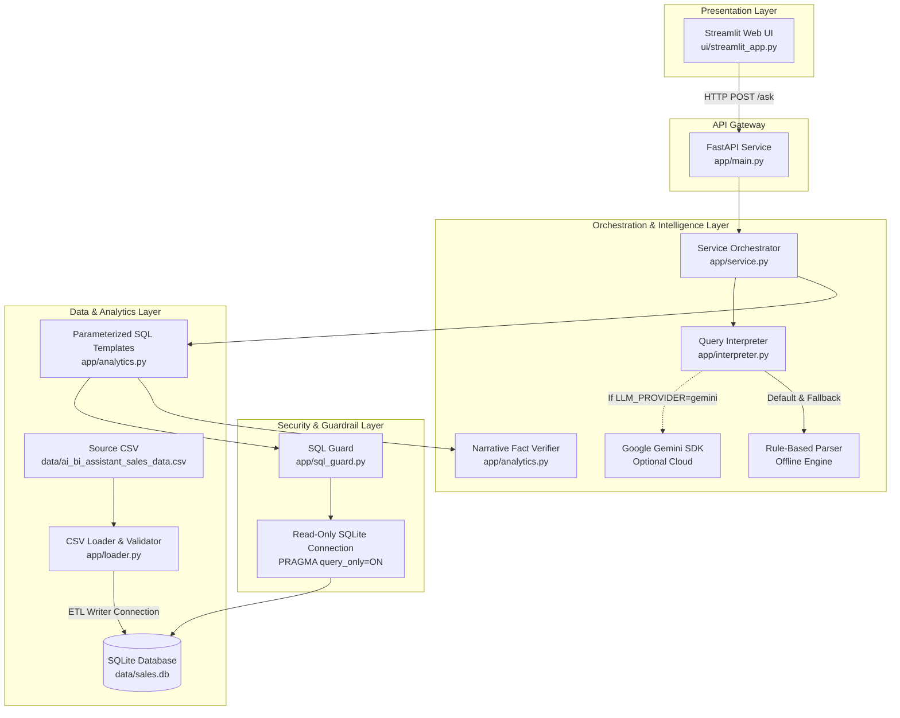
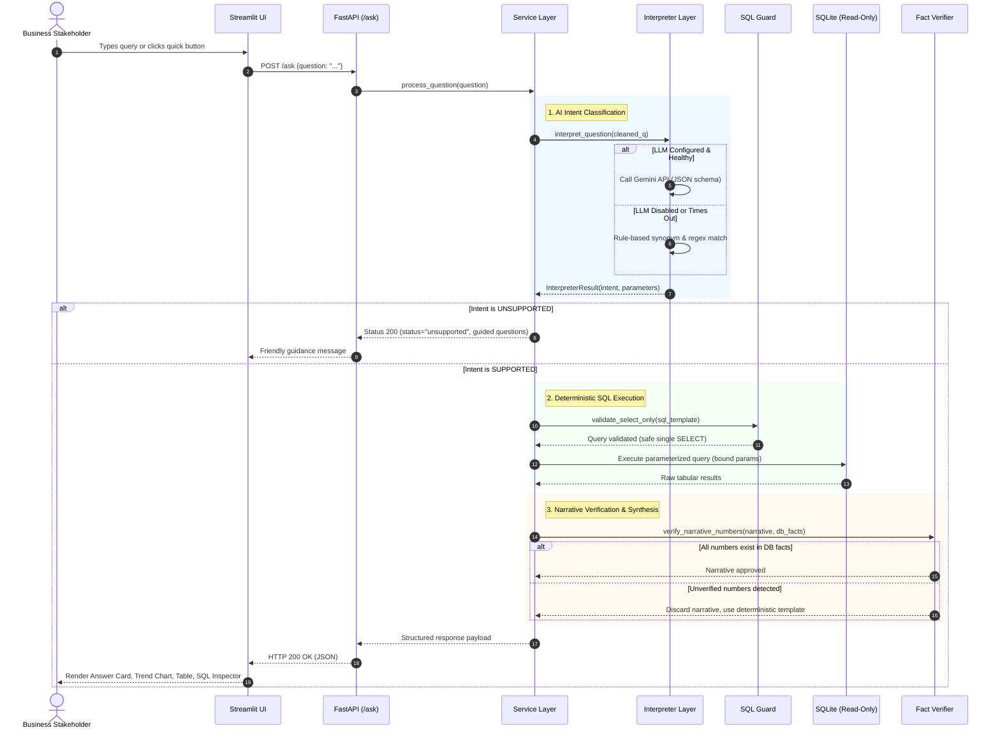

# System Architecture & Technical Design

This document details the architectural blueprint, data model, component interactions, and engineering trade-offs of the Mini AI Business Intelligence Assistant.

---

## 1. High-Level Component Architecture

The application adopts a modular, tiered architecture separating user presentation, API routing, AI intent extraction, database security guardrails, and deterministic analytics execution.



---

## 2. Request-Flow Sequence Diagram

The following sequence diagram illustrates the lifecycle of a business user's query:



---

## 3. Database Schema

The sales data is persisted in a relational SQLite table designed to preserve auditability and facilitate fast query execution:

```sql
CREATE TABLE sales (
    transaction_id TEXT PRIMARY KEY,
    order_date TEXT,          -- ISO YYYY-MM-DD
    order_month TEXT,         -- ISO YYYY-MM (for fast group-bys)
    product TEXT,             -- Normalized trimmed product name
    category TEXT,            -- Product category
    region TEXT,              -- Sales region (North, South, East, West)
    sales_channel TEXT,       -- Online / Retail
    quantity INTEGER,         -- Transaction units (NULL if missing)
    unit_price REAL,          -- Price per unit (NULL if missing, never imputed)
    discount_amount REAL,     -- Line discount amount
    status TEXT,              -- Original status (Completed, Returned, etc.)
    line_revenue REAL,        -- Calculated as (quantity * unit_price - discount_amount)
    is_included INTEGER NOT NULL, -- 1 = included in BI analytics, 0 = excluded
    exclusion_reason TEXT     -- Rationale for exclusion (e.g. 'returned', 'zero_quantity')
);

CREATE INDEX idx_sales_order_month ON sales(order_month);
CREATE INDEX idx_sales_product ON sales(product);
CREATE INDEX idx_sales_region ON sales(region);
CREATE INDEX idx_sales_is_included ON sales(is_included);
```

---

## 4. Architectural Decisions & Trade-Offs

### 1. Intent Classification vs. Free-Form Text-to-SQL
- **The Dilemma**: Many LLM applications allow the model to freely draft SQL queries directly from user text.
- **The Risk**: Text-to-SQL models frequently hallucinate column names, apply incorrect joins, fail on nuanced business definitions (such as whether discount is per-unit or per-line), and expose the system to catastrophic injection vulnerabilities.
- **The Decision**: We restrict the AI's role strictly to **Intent Extraction and Parameter Parsing** (producing validated JSON). Fixed, audited parameterized SQL queries written by engineers execute the calculations.
- **The Trade-Off**: Decreases arbitrary question flexibility, but achieves **100% mathematical correctness, zero hallucination of figures, and zero SQL injection risk**.

### 2. Physical Separation of Database Connections
- **The Decision**: The system maintains two distinct SQLite connection factories:
  1. `get_writer_connection()`: Used exclusively during ETL initialization by `loader.py`.
  2. `get_readonly_connection()`: Used exclusively by the analytics service. Configured with URI `file:...mode=ro` and engine pragma `PRAGMA query_only = ON`.
- **The Trade-Off**: Minor overhead of opening separate connections, but establishes ironclad isolation: the analytics layer physically cannot alter data.

### 3. Non-Destructive Audit Trail vs. Dropping Bad Rows
- **The Decision**: In raw transaction data, records like `TXN0033` (Returned), `TXN0034` (Quantity = 0), and `TXN0051` (Missing Unit Price) are invalid for revenue calculations. Instead of discarding them during load time, all 51 rows are saved. Excluded records are flagged with `is_included = 0` and an explicit `exclusion_reason`.
- **The Trade-Off**: Requires filtering `WHERE is_included = 1` on every query, but delivers enterprise-grade data auditability. Stakeholders can inspect why specific rows were omitted via the `/data-quality` endpoint.

### 4. Deterministic Tie-Breaking
- **The Decision**: When querying for "top product" or "top region", ties in revenue could result in non-deterministic ordering across query runs. The queries enforce secondary alphabetical sorting:
  `ORDER BY total_revenue DESC, product ASC LIMIT 1`.
- **The Benefit**: Ensures reproducible and predictable responses.

### 5. Offline Rule-Based Engine as Primary & Fallback
- **The Decision**: We implemented a regex and synonym pattern matcher (`rule_based_interpret`) as the foundation. The LLM is an optional enhancement.
- **The Trade-Off**: Complex queries outside the defined patterns require expanding the regex library, but the application functions reliably with **zero internet, zero API keys, and zero external costs**.
